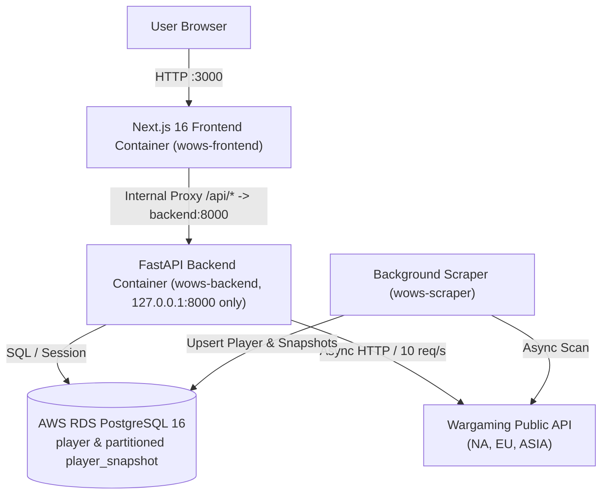

# Production Deployment & Operations Guide

This guide covers operational access, architecture, and deployment procedures for the World of Warships Stats Tracker on AWS.

## Quick Reference Links (Production Server)

| Service | Endpoint | Description |
| :--- | :--- | :--- |
| **Web Application** | [http://44.253.134.12:3000](http://44.253.134.12:3000) | Next.js 16 Neon Tactical UI & Charts |
| **Overview Aggregate API** | [http://44.253.134.12:3000/api/stats/overview](http://44.253.134.12:3000/api/stats/overview) | Global player & battle summary counters (via the frontend's `/api` proxy) |
| **Backend API (Swagger Docs)** | `http://localhost:8000/docs` through an SSH tunnel | Backend is host-only; see [RUNBOOK §4](docs/RUNBOOK.md#4-internal-developer-rest-api-internal) |

---

## AWS Infrastructure Details

- **EC2 Instance:** `t3.small` (Ubuntu 24.04 LTS) in `us-west-2` (Oregon)
- **Elastic IP (Static):** `44.253.134.12` (Whitelisted for Wargaming Developer API)
- **RDS PostgreSQL 16:** `wows-stats-db.cy2fcthbqjrl.us-west-2.rds.amazonaws.com:5432/wows_stats`
- **Application Directory:** `/home/ubuntu/app`
- **SSH Command:**
  ```bash
  ssh -i ~/.ssh/wows-stats-ec2-key.pem ubuntu@44.253.134.12
  ```

---

## System Architecture Diagram



---

## Operational Commands

### 1. Check Container Health
```bash
ssh -i ~/.ssh/wows-stats-ec2-key.pem ubuntu@44.253.134.12 \
  "sudo docker ps --format 'table {{.Names}}\t{{.Status}}\t{{.Ports}}'"
```

### 2. View Service Logs
```bash
# View backend API logs
ssh -i ~/.ssh/wows-stats-ec2-key.pem ubuntu@44.253.134.12 "sudo docker logs wows-backend --tail 50 -f"

# View scraper worker logs
ssh -i ~/.ssh/wows-stats-ec2-key.pem ubuntu@44.253.134.12 "sudo docker logs wows-scraper --tail 50 -f"

# View frontend logs
ssh -i ~/.ssh/wows-stats-ec2-key.pem ubuntu@44.253.134.12 "sudo docker logs wows-frontend --tail 50 -f"
```

### 3. Deploying New Code to Production
```bash
ssh -i ~/.ssh/wows-stats-ec2-key.pem ubuntu@44.253.134.12 << 'EOF'
cd /home/ubuntu/app
sudo git pull origin master
sudo docker compose up -d --build
EOF
```

### 4. Database Initialization / Partition Generation
The tables and monthly range partitions are initialized automatically, but can also be manually run:
```bash
ssh -i ~/.ssh/wows-stats-ec2-key.pem ubuntu@44.253.134.12 \
  "sudo docker exec wows-backend python init_db.py"
```

---

## Environment Configuration

Production `.env` location on EC2: `/home/ubuntu/app/backend/.env`
```env
DATABASE_URL=postgresql://wows_admin:<DB_PASSWORD>@wows-stats-db.cy2fcthbqjrl.us-west-2.rds.amazonaws.com:5432/wows_stats
DB_HOST=wows-stats-db.cy2fcthbqjrl.us-west-2.rds.amazonaws.com
DB_NAME=wows_stats
DB_USER=wows_admin
DB_PASSWORD=<DB_PASSWORD>
WARGAMING_APP_ID=<WARGAMING_APP_ID>
AWS_DEFAULT_REGION=us-west-2
S3_ANALYTICS_BUCKET=wows-stats-analytics
INTERNAL_API_KEY=<random 64-hex>
ANALYST_DB_PASSWORD=<random>
GF_SECURITY_ADMIN_PASSWORD=<random>
```
The file is `chmod 600` and never committed. Secret handling and rotation: [RUNBOOK §9](docs/RUNBOOK.md#9-secrets-network-access--infrastructure-as-code).
